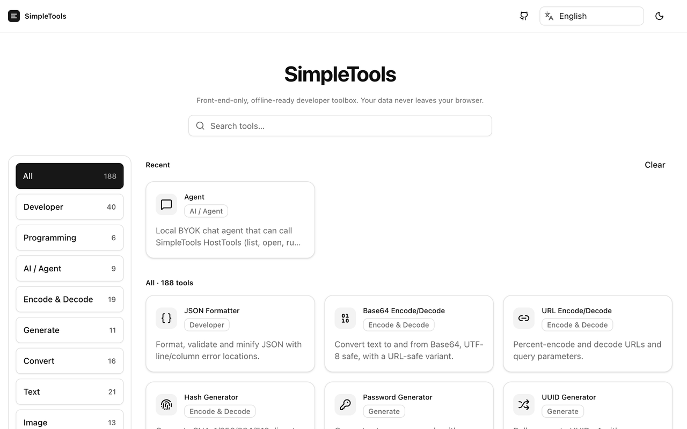
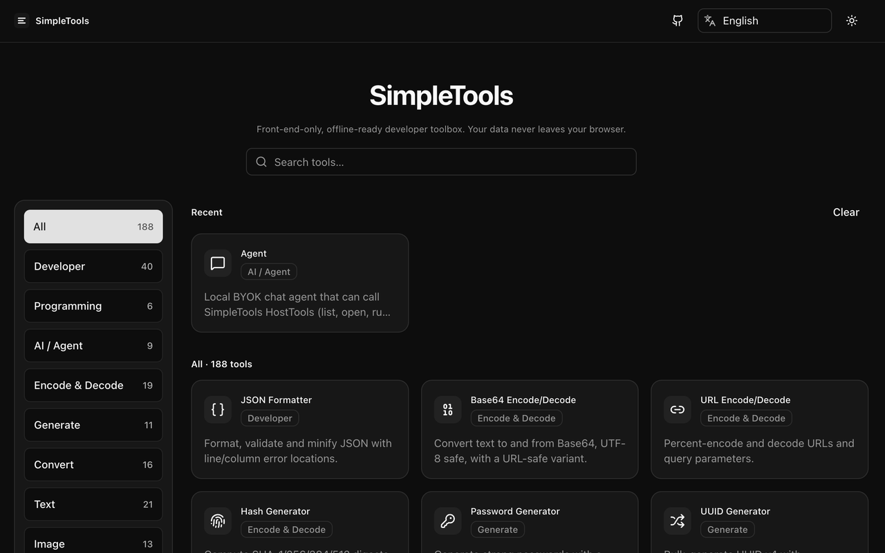
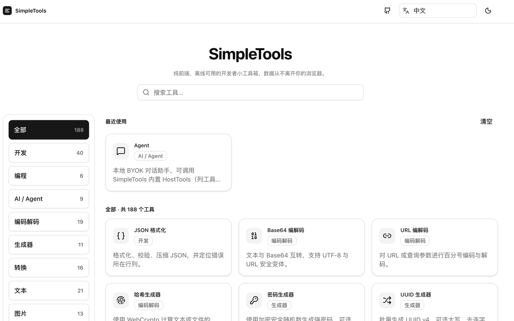

# SimpleTools

[English](./README_EN.md) | 中文

纯前端、离线可用的开发者小工具箱。所有处理都在本地浏览器完成，**数据从不离开你的设备**。

仓库：https://github.com/SimpleAI2026/SimpleTools


## 截图







## 特性

- **网页版 199 个工具 / 插件版 189 个**（以 `src/registry` 注册表为准；插件版的编程分类只保留 6 种语言）
- **8 种界面语言**：简体中文、English、日本語、한국어、Deutsch、Français、Español、Português (Brasil)，语言与主题（亮/暗）本地持久化
- **注册表驱动**：搜索、分类、收藏、最近使用、按工具代码分割
- **纯前端 / 可离线**：无业务后端；文件在浏览器内处理并下载；ImageMagick、Tesseract、PDFium、FFmpeg 与编程运行时等 WASM 引擎同源按需加载
- **移动端适配**：窄屏（390px）响应式布局
- 技术栈：Vue 3、Vite、TypeScript、Tailwind CSS 4、shadcn-vue（reka-ui）、vue-i18n、Pinia、Yarn 4
- **Agent（BYOK，实验）**：应用内 `/agent` 自带密钥的 OpenAI 兼容对话 + HostTools；密钥仅存本机。Chrome 插件版暂无 host 权限，扩展内直连云端 API 可能失败（优先网页版）。

## 工具分类

| 分类 | 网页 | 插件 | 说明 |
|---|---:|---:|---|
| 开发 | 40 | 40 | JSON 格式化 / 对比 / 转 TS、YAML、正则与速查、JWT、代码格式化、cron 解析与 crontab 生成、docker run 转 Compose、UA 解析、MIME、键码、Meta 标签、Git 速查、表达式计算、CIDR / IPv4 范围、MAC 厂商查询、设备信息等 |
| 编程 | 15 | 6 | 按语言独立入口：编辑器 + 运行 / 停止 + 终端 + 快速入门；插件版仅 JavaScript、TypeScript、SQLite、Lua、Shell、Java |
| AI / Agent | 9 | 9 | 本地 BYOK Agent、Token 计数、费用估算、Prompt 检查与脱敏、注入扫描、MCP / 工具定义、Agent 指令生成 |
| 编码解码 | 19 | 19 | Base64（文本 / 文件）、Base32、URL、Hash、HMAC、bcrypt、AES、RSA 密钥对、TOTP / HOTP、BIP-39、密码强度、Basic Auth 等 |
| 生成器 | 11 | 11 | 密码、UUID、ULID、二维码、Lorem、随机数、MAC 地址、IPv6 ULA、随机端口等 |
| 转换 | 17 | 16 | 时间戳、命名风格、色值、CSV↔JSON、JSON↔YAML / XML、TOML↔JSON / YAML、单位换算等 |
| 文本 | 21 | 21 | 字数统计、Diff、记事本、行处理与列表转换、所见即所得 HTML、ASCII 艺术字、Emoji、NATO 字母、邮箱规范化、Safelink 解码等 |
| 图片 | 14 | 14 | 证件照（本地人脸检测 + 抠图换底 + 排版）、缩放、编辑、滤镜、格式转换、切图、ImageMagick、OCR、SVG 占位图、设计辅助等 |
| 音视频 | 3 | 3 | FFmpeg 处理、字幕工具、视频交付预检 |
| PDF | 28 | 28 | 旋转、裁剪、水印、页码、加解密、脱敏、对比、编辑、签名信息、PDFium 预览，与 Office / 图片 / 文本互转 |
| 办公 | 19 | 19 | Excel / Word / PPT 查看、转换、合并、创建；百分比、ETA、IBAN、电话号码解析、秒表、基准测试等 |
| 压缩 | 3 | 3 | gzip、图片压缩、PDF 压缩 |
| **合计** | **199** | **189** | |

> 部分 `src/tools` 下的目录若未写入注册表，不会出现在首页；README 以注册表为准。相机录制工具在 `src/tools/camera-recorder`，归入图片分类。

## 快速开始

要求：**Node.js ≥ 20**，启用 Corepack 以使用 Yarn 4。

```bash
corepack enable
./build.sh dev          # 开发服务器，默认 http://127.0.0.1:5173
./build.sh build        # 类型检查 + 生产构建 → dist/
./build.sh preview      # 本地预览 dist/
./build.sh lint         # ESLint + vue-tsc
./build.sh test         # Vitest 单测
./build.sh chrome       # Chrome MV3 扩展 → chrome-extension/dist + .zip
./build.sh vscode       # VS Code 扩展 → .vsix（webview）
```

也可以直接使用 Yarn 脚本：`yarn dev` / `yarn build` / `yarn preview` / `yarn lint` / `yarn test`。

部署目标为**本地静态站点**（`vite preview` 或任意静态服务器托管 `dist/`）。

## 目录结构

```
SimpleTools/
├── build.sh            # dev | build | preview | lint | test | chrome | vscode
├── chrome-extension/   # Chrome MV3 打包脚本与清单
├── vscode-extension/   # VS Code 扩展宿主与打包脚本
├── docs/               # README 截图等文档资源
├── plan/               # 实施计划与调研笔记
├── public/             # 静态资源（favicon、样例图、offline/ 运行时等）
├── scripts/            # 版本号、多语言、编程运行时资源脚本
├── src/
│   ├── components/     # 站点外壳与 UI
│   ├── i18n/           # 8 种语言本地化
│   ├── pages/          # 首页、工具页、404
│   ├── registry/       # 工具注册表（分类元数据）
│   │   └── tools/      # 按分类拆分的注册条目
│   ├── tools/          # 各工具实现（logic + Vue）
│   └── ...
└── thirdparty/         # 仅本地参考（已 gitignore，勿依赖）
```

## 扩展版本

- **Chrome**：`./build.sh chrome` → 在 `chrome://extensions` 开启开发者模式，加载 `chrome-extension/dist/`（详见 `chrome-extension/README.md`）。
- **VS Code**：`./build.sh vscode` → `code --install-extension vscode-extension/simpletools-*.vsix`，命令面板运行 **SimpleTools: Open**（详见 `vscode-extension/README.md`）。
- 扩展构建使用相对路径 `base: './'` + Hash 路由；网页版 `./build.sh build` 仍为 History 路由。
- 网页右上角可下载安装包：`./build.sh chrome` / `./build.sh vscode` 会把产物同步到 `public/downloads/`（`simpletools-chrome.zip`、`simpletools-vscode.vsix`）。`./build.sh build` 仅在产物已存在时复制，不会强制重编扩展。

## 说明

- `thirdparty/`（如 it-tools、LiYing 等参考实现）仅供对照，**不得被应用 import / 依赖**，也不纳入版本库；GPL / AGPL 项目只参考思路，不复制代码。
- `public/pdfjs/`、`public/offline/` 由构建 / 资源管线准备，已忽略。
- 编程运行时清单已提交在 `src/tools/code-playground/core/runtime-manifest.json`，正常构建不读取 `../SimpleCode`。若要在本地真正运行各语言，需先执行一次 `node scripts/code-playground-assets.mjs --sync`，从同级 `../SimpleCode` 复制 WASM 并刷新清单。
- 每次 `./build.sh chrome` / `./build.sh vscode` 会把根项目、Chrome、VS Code 版本号同步 +0.0.1。

## License

私有仓库。代码与资源版权归 SimpleAI2026 / 作者所有，未经许可请勿公开分发。
