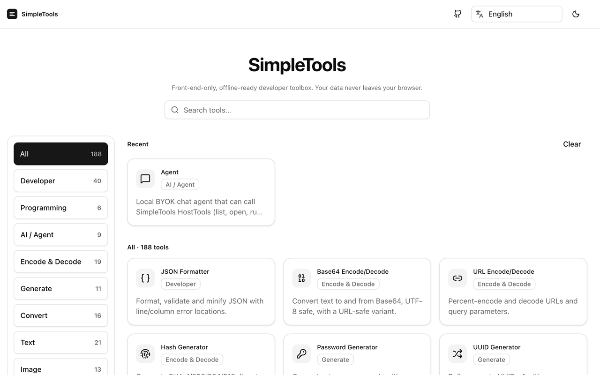
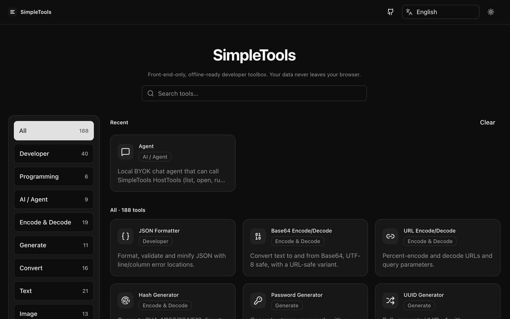
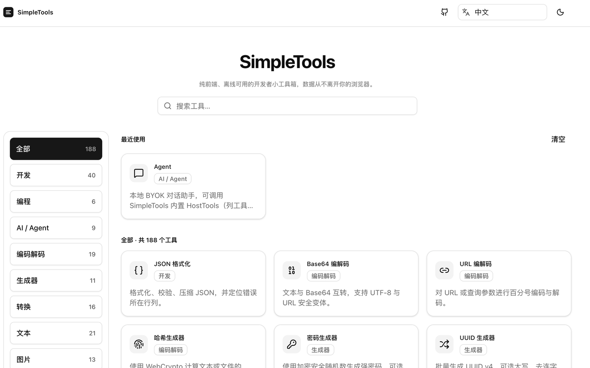

# SimpleTools

[English](./README_EN.md) | [中文](./README.md)

A front-end-only, offline-ready developer toolbox. Everything runs in your browser — **your data never leaves your device**.

Repository: https://github.com/SimpleAI2026/SimpleTools


## Screenshots







## Features

- **199 tools on the web, 189 in the extensions** (counted from the `src/registry` registry; the extensions keep 6 programming languages)
- **8 UI languages**: 简体中文, English, 日本語, 한국어, Deutsch, Français, Español, Português (Brasil), with persisted locale and light/dark theme
- **Registry-driven** search, categories, favorites, recent tools, and per-tool code splitting
- **No backend, works offline**: files are processed locally and downloaded from the browser; WASM engines (ImageMagick, Tesseract, PDFium, FFmpeg, code runtimes) are same-origin and load on demand
- **Mobile-friendly**: responsive layout down to 390px
- Stack: Vue 3, Vite, TypeScript, Tailwind CSS 4, shadcn-vue (reka-ui), vue-i18n, Pinia, Yarn 4
- **Agent (BYOK, experimental):** in-app `/agent` OpenAI-compatible chat with your own key + HostTools; keys stay on-device. The Chrome extension has no host permissions yet, so direct cloud API calls may fail (prefer the web build).

## Categories

| Category | Web | Extension | Examples |
|---|---:|---:|---|
| Developer | 40 | 40 | JSON format / diff / to TS, YAML, regex + cheatsheet, JWT, formatters, cron parser + crontab builder, docker run → Compose, UA parser, MIME, keycodes, meta tags, Git cheatsheet, math evaluator, CIDR / IPv4 ranges, MAC vendor lookup, device info |
| Programming | 15 | 6 | One page per language: editor, run / stop, terminal, quick start; extensions keep JavaScript, TypeScript, SQLite, Lua, Shell, Java |
| AI / Agent | 9 | 9 | Local BYOK agent, token counter, API cost estimator, prompt linter / redactor / injection scan, MCP & tool defs, agent instructions |
| Encode & Decode | 19 | 19 | Base64 (text / files), Base32, URL, hash, HMAC, bcrypt, AES, RSA key pairs, TOTP / HOTP, BIP-39, password strength, basic auth |
| Generate | 11 | 11 | Password, UUID, ULID, QR, Lorem, random values, MAC addresses, IPv6 ULA, random ports |
| Convert | 17 | 16 | Timestamp, case styles, colors, CSV↔JSON, JSON↔YAML / XML, TOML↔JSON / YAML, units |
| Text | 21 | 21 | Word count, diff, notepad, line tools + list converter, WYSIWYG HTML, ASCII art, emoji, NATO alphabet, email normalizer, Safelink decoder |
| Image | 14 | 14 | ID photos (local face detection + background replacement + print sheets), resize, edit, filters, format convert, split, ImageMagick, OCR, SVG placeholders, design helpers |
| Audio & video | 3 | 3 | FFmpeg, subtitle toolkit, video delivery preflight |
| PDF | 28 | 28 | Rotate, crop, watermark, page numbers, encrypt, redact, compare, edit, signature info, PDFium preview, convert to/from Office, images, text |
| Office | 19 | 19 | Excel / Word / PPT view, convert, merge, create; percentage, ETA, IBAN, phone parser, stopwatch, benchmarks |
| Compress | 3 | 3 | gzip, image compress, PDF compress |
| **Total** | **199** | **189** | |

> Folders under `src/tools` that are not registered are hidden from the home page. README counts follow the registry. The camera recorder lives in the Image category.

## Quick start

Requires **Node.js ≥ 20** and Yarn 4 via Corepack.

```bash
corepack enable
./build.sh dev          # Dev server (default http://127.0.0.1:5173)
./build.sh build        # Typecheck + production build → dist/
./build.sh preview      # Serve dist/ locally
./build.sh lint         # ESLint + vue-tsc
./build.sh test         # Vitest
./build.sh chrome       # Chrome MV3 extension → chrome-extension/dist + .zip
./build.sh vscode       # VS Code extension → .vsix (webview)
```

Yarn scripts also work: `yarn dev` / `yarn build` / `yarn preview` / `yarn lint` / `yarn test`.

Intended deployment is a **local static site** (`vite preview` or any static host for `dist/`).

## Layout

```
SimpleTools/
├── build.sh            # dev | build | preview | lint | test | chrome | vscode
├── chrome-extension/   # Chrome MV3 packaging + build script
├── vscode-extension/   # VS Code extension host + packaging
├── docs/               # README screenshots and docs assets
├── plan/               # Implementation plans and research notes
├── public/             # Static assets (favicon, samples, offline/ runtimes)
├── scripts/            # Version, locale, and code runtime asset scripts
├── src/
│   ├── components/
│   ├── i18n/           # 8 locales
│   ├── pages/
│   ├── registry/       # Tool registry (source of truth for counts)
│   │   └── tools/
│   ├── tools/          # Per-tool implementations
│   └── ...
└── thirdparty/         # Local reference only (gitignored; do not depend on it)
```

## Extensions

- **Chrome**: `./build.sh chrome` → enable Developer mode on `chrome://extensions` and Load unpacked `chrome-extension/dist/` (see `chrome-extension/README.md`).
- **VS Code**: `./build.sh vscode` → `code --install-extension vscode-extension/simpletools-*.vsix`, then **SimpleTools: Open** from the Command Palette (see `vscode-extension/README.md`).
- Extension builds use relative `base: './'` + hash routing; the web build (`./build.sh build`) keeps history routing.
- The web header offers downloads: `./build.sh chrome` / `./build.sh vscode` sync artifacts into `public/downloads/` (`simpletools-chrome.zip`, `simpletools-vscode.vsix`). `./build.sh build` copies them only if already present (no forced extension rebuild).

## Notes

- `thirdparty/` (e.g. it-tools, LiYing references) is for comparison only, **must not be imported** by the app, and is not committed; GPL / AGPL projects are referenced for ideas only, never copied.
- `public/pdfjs/` and `public/offline/` are prepared by the build / asset pipeline and are ignored.
- The code runtime catalog is committed at `src/tools/code-playground/core/runtime-manifest.json`, so normal builds never read `../SimpleCode`. To actually run languages locally, run `node scripts/code-playground-assets.mjs --sync` once to copy WASM from a sibling `../SimpleCode` and refresh the catalog.
- Each `./build.sh chrome` / `./build.sh vscode` bumps the root, Chrome, and VS Code versions together by 0.0.1.

## License

Private repository. All rights reserved by SimpleAI2026 / the authors.
