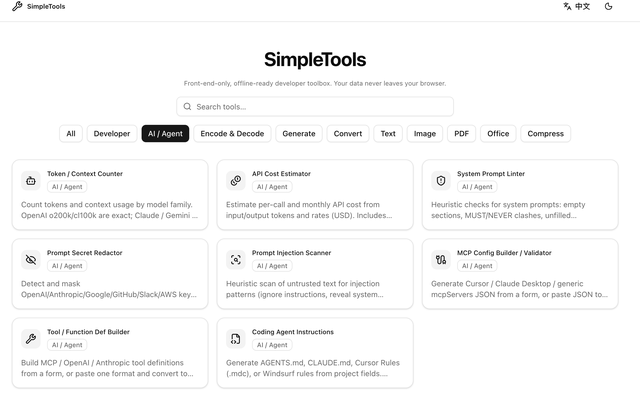
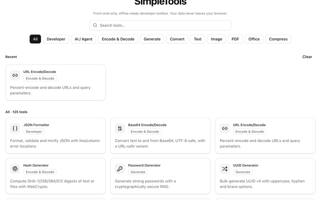
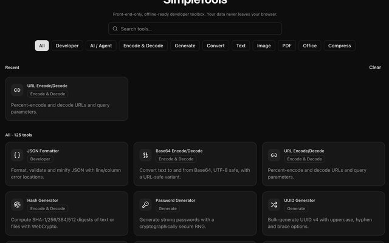
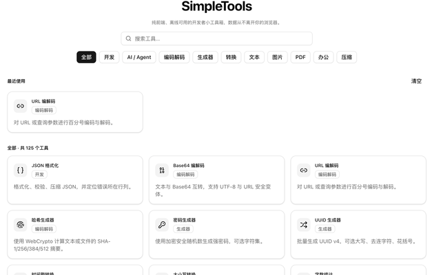
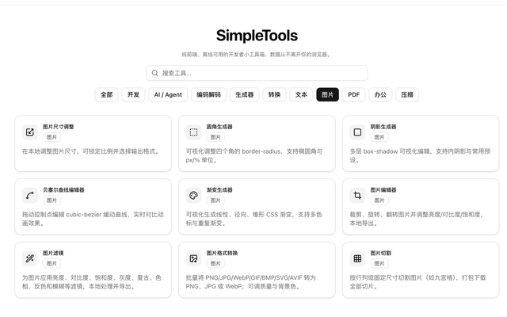

# SimpleTools

[English](./README_EN.md) | [中文](./README.md)

A front-end-only, offline-ready developer toolbox. Everything runs in your browser — **your data never leaves your device**.

Repository: https://github.com/SimpleAI2026/SimpleTools


## Screenshots











## Features

- **125 tools** (counted from the `src/registry` registry, not from `src/tools` folder count)
- **Bilingual** UI (Chinese / English), with persisted locale and light/dark theme
- **Registry-driven** search, categories, favorites, recent tools, and per-tool code splitting
- **No backend**: files are processed locally and downloaded from the browser
- Stack: Vue 3, Vite, TypeScript, Tailwind CSS 4, shadcn-vue (reka-ui), vue-i18n, Pinia, Yarn 4

## Categories

| Category | Count | Examples |
|---|---:|---|
| Developer | 25 | JSON, regex, JWT, formatters, network / chmod helpers |
| AI / Agent | 8 | Token counter, API cost estimator, prompt linter / redactor / injection scan, MCP & tool defs, agent instructions |
| Encode & Decode | 11 | Base64, URL, hash, AES, Morse, … |
| Generate | 7 | Password, UUID, QR, Lorem, random values |
| Convert | 15 | Timestamp, case styles, colors, CSV↔JSON, units, … |
| Text | 10 | Word count, diff, notepad, cleanup, … |
| Image | 9 | Resize, edit, filters, format convert, split, design helpers |
| PDF | 26 | Rotate, watermark, encrypt, redact, convert to/from Office & images |
| Office | 11 | Excel / Word / PPT view, convert, merge, create |
| Compress | 3 | gzip, image compress, PDF compress |
| **Total** | **125** | |

> Folders under `src/tools` that are not registered are hidden from the home page. README counts follow the registry.

## Quick start

Requires **Node.js ≥ 20** and Yarn 4 via Corepack.

```bash
corepack enable
./build.sh dev          # Dev server (default http://127.0.0.1:5173)
./build.sh build        # Typecheck + production build → dist/
./build.sh preview      # Serve dist/ locally
./build.sh lint         # ESLint + vue-tsc
./build.sh test         # Vitest
./build.sh chrome       # Chrome MV3 extension → chrome-extension/dist + .zip
./build.sh vscode       # VS Code extension → .vsix (webview)
```

Yarn scripts also work: `yarn dev` / `yarn build` / `yarn preview` / `yarn lint` / `yarn test`.

Intended deployment is a **local static site** (`vite preview` or any static host for `dist/`).

## Layout

```
SimpleTools/
├── build.sh            # dev | build | preview | lint | test | chrome | vscode
├── chrome-extension/   # Chrome MV3 packaging + build script
├── vscode-extension/   # VS Code extension host + packaging
├── plan/               # Implementation plans and research notes
├── public/             # Static assets
├── src/
│   ├── components/
│   ├── i18n/
│   ├── pages/
│   ├── registry/       # Tool registry (source of truth for counts)
│   │   └── tools/
│   ├── tools/          # Per-tool implementations
│   └── ...
└── thirdparty/         # Local reference only (gitignored; do not depend on it)
```

## Extensions

- **Chrome**: `./build.sh chrome` → enable Developer mode on `chrome://extensions` and Load unpacked `chrome-extension/dist/` (see `chrome-extension/README.md`).
- **VS Code**: `./build.sh vscode` → `code --install-extension vscode-extension/simpletools-*.vsix`, then **SimpleTools: Open** from the Command Palette (see `vscode-extension/README.md`).
- Extension builds use relative `base: './'` + hash routing; the web build (`./build.sh build`) keeps history routing.
- The web header offers downloads: `./build.sh chrome` / `./build.sh vscode` sync artifacts into `public/downloads/` (`simpletools-chrome.zip`, `simpletools-vscode.vsix`). `./build.sh build` copies them only if already present (no forced extension rebuild).

## Notes

- `thirdparty/` (e.g. BrainCoder reference) is large and **must not be imported** by the app; it is not committed.
- `public/pdfjs/` is prepared by the asset pipeline and is ignored.
- WASM-backed tools (some PDF merge / OCR paths) are deferred; registered tools use pure JS implementations.

## License

Private repository. All rights reserved by SimpleAI2026 / the authors.
